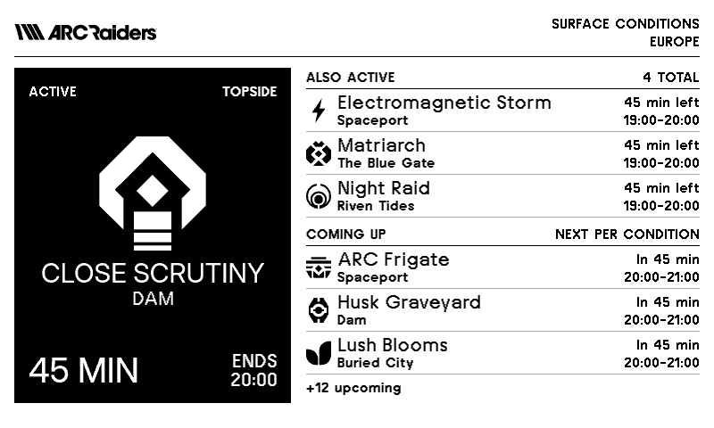
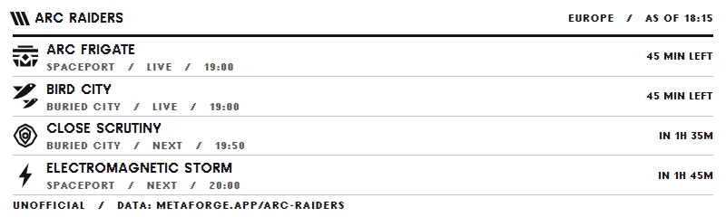
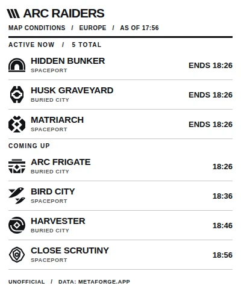
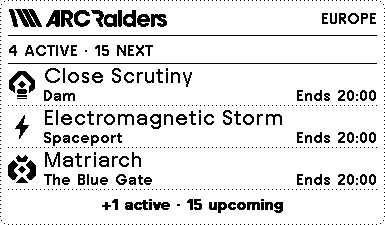

# ARC Raiders

An unofficial TRMNL plugin showing current and upcoming ARC Raiders map conditions using the [MetaForge event schedule](https://metaforge.app/arc-raiders).

Choose a matchmaking region in the plugin settings. The plugin supports full, half horizontal, half vertical and quadrant layouts, and refreshes every 30 minutes. Times use your TRMNL account's time zone. Conditions reflect the schedule at the displayed update time; start and end times remain useful between refreshes.



Sample schedule, not live conditions.

| Half horizontal | Half vertical | Quadrant |
| --- | --- | --- |
|  |  |  |

## Develop locally

Install [trmnlp](https://github.com/usetrmnl/trmnlp), then run:

```sh
cd TRMNL
trmnlp serve
```

The local preview uses static sample data; the plugin polls MetaForge when running on TRMNL. Templates, settings and the JavaScript transform are in [TRMNL/src](TRMNL/src/).

The GitHub Actions publishing workflow is manually triggered and requires the `TRMNL_API_KEY` and `TRMNL_PLUGIN_SETTING_ID` repository secrets. It pushes the plugin to the specified TRMNL plugin setting.

ARC Raiders is a trademark of Embark Studios. This project is unofficial and is not affiliated with Embark Studios or MetaForge.
