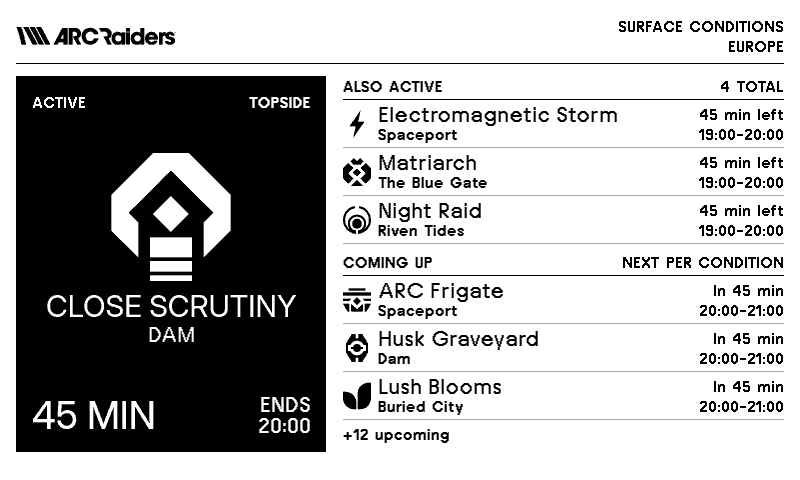
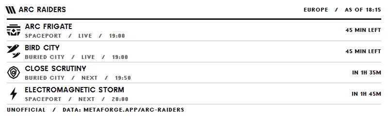
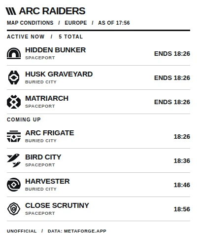
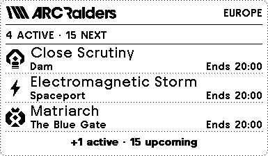

# ARC Raiders plugin guide

## Setup

Create a private plugin on TRMNL using Polling, Framework 3.4.6, Node Serverless and a 30-minute refresh interval.

Use [settings.yml](src/settings.yml) for the polling request and region selector. Add [transform.js](src/transform.js) as the serverless transform and copy the five Liquid files in [src/](src/) to their matching markup tabs.

Choose your matchmaking region in the plugin settings. Times use your TRMNL account time zone. The full view shows a countdown calculated at each refresh. Half Horizontal has separate Active and Upcoming columns. Half Vertical and Quadrant combine both into one list, with active conditions first. Every layout warns when the source data is more than three hours old.

## Previews

Sample schedule, not live conditions.



| Half horizontal | Half vertical | Quadrant |
| --- | --- | --- |
|  |  |  |

## Checks

With Node.js 22 and Docker installed, run from the repository root:

```sh
node --test TRMNL/tests/transform.test.cjs
./scripts/preview
```

The preview command uses `trmnl/trmnlp:v0.32.3` to render fixed sample data on OG and X in both orientations, plus a 2-bit OG landscape sample. Checks cover empty and stale schedules, long names, overnight events and daylight-saving changes. They also enforce minimum rendered text sizes of 16px on OG and 21 CSS px on X.

Cropped screenshots are written to `TRMNL/_build/previews/`; open `TRMNL/_build/report/index.html` for the browser test report.

## Publish

CI runs the transform tests, browser layout checks and template linting. Changes to `TRMNL/src/` on `main` publish automatically after those checks pass; the publishing workflow can also be triggered manually. It uses the `TRMNL_API_KEY` and `TRMNL_PLUGIN_SETTING_ID` repository secrets.
